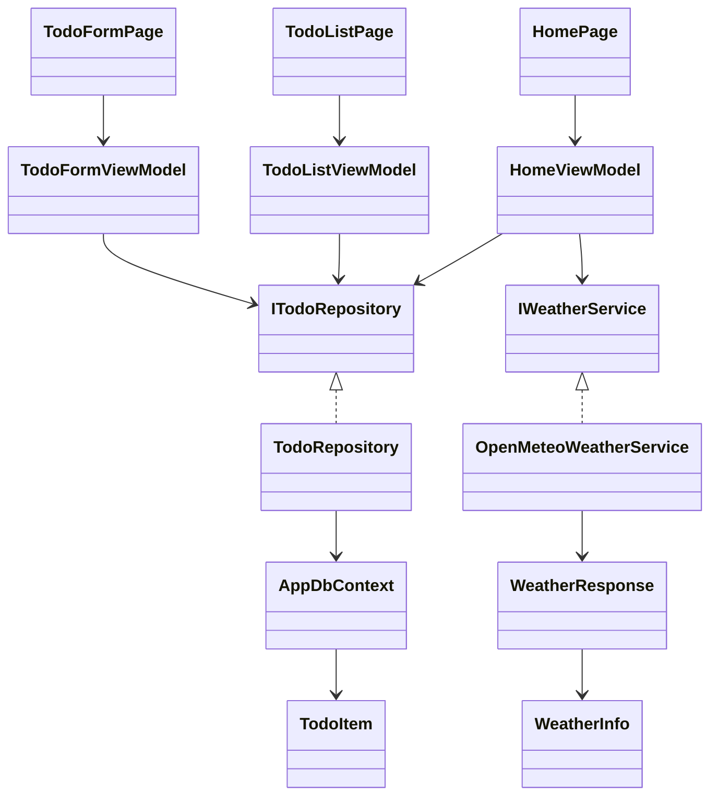

# LifeManagementApp

.NET 9 / .NET MAUI 9 -sovellus Windowsille. Etusivu näyttää kolme tärkeintä keskeneräistä tehtävää ja Vaasan sään. Kitesurf-ilmoitus näkyy, kun tuuli ylittää 5 m/s. Tehtävälistaa voi lajitella prioriteetin tai eräpäivän mukaan. Tehtäviä voi lisätä, muokata ja merkitä tehdyiksi. SQLite säilyttää tehtävät sovelluksen sulkemisen jälkeen.

## Käynnistä Windowsissa

1. Pura ZIP. Tarvitset Windowsin, .NET 9 SDK:n ja Visual Studion **.NET Multi-platform App UI development** -työkuorman. Asenna työkuorma Visual Studio Installerissa. Tarkista projektikansiossa komennolla `dotnet --version`, että valittu SDK on 9.0.x.
2. Avaa projektikansiosta `LifeManagementApp.csproj` Visual Studiossa ja odota NuGet-pakettien palautumista.
3. Valitse ajokohteeksi **Windows Machine** ja paina **F5**. Ensimmäisellä käynnistyksellä tehtävälista on tyhjä. Luo tehtäviä **Tehtävät → Lisää tehtävä**.

Käynnistäminen PowerShellistä projektikansiossa, jos Windowsin MAUI-työkuorma on asennettu myös käytössä olevalle SDK:lle

```powershell
dotnet build -t:Run -f net9.0-windows10.0.19041.0
```

Tietokanta luodaan nimellä `todos.db` käyttäjän sovellusdatakansioon ensimmäisen tietokantaoperaation yhteydessä. Sää tulee Open-Meteosta ilman API-avainta. Sovelluksen tehtävätoiminnot käyttävät paikallista tietokantaa ja toimivat myös ilman verkkoyhteyttä.

## Luokkakaavio



## Kokeile ennen esittelyä

1. Yritä tallentaa tyhjä otsikko ja pelkkiä välilyöntejä.
2. Lisää neljä tehtävää. Anna kahdelle sama prioriteetti ja eri eräpäivät. Tarkista molemmat lajittelut ja etusivun kolme tehtävää.
3. Valitse tehtävä, paina **Muokkaa valittua**, merkitse se tehdyksi ja tallenna. Tehtävä näkyy listalla tehtynä ja poistuu etusivun kärjestä.
4. Sulje sovellus ja avaa uudelleen. Tarkista, että tiedot säilyivät.
5. Kokeile sääpäivitystä ilman verkkoa. Tarkista virheilmoitus ja tehtävälistan toiminta. Esittelyharjoituksessa voit hetkeksi muuttaa arvoa `KitesurfWindLimit` ja käynnistää uudelleen.

Avaa [KOODIOPAS.md](KOODIOPAS.md), kun haluat seurata yksittäisen toiminnon kulkua ja harjoitella esittelykysymyksiä.

## Tarkistettu tässä versiossa

Yhteiset MAUI-XAML-sivut ja niiden compiled bindingit käännettiin. SQLite-lisäys, päivitys, lajittelut, otsikkovalidointi ja sään raja- sekä virhetilanteet tarkistettiin. Windowsin oman WinUI-käynnistyksen viimeistely ja käyttöliittymän kokeilu tehdään Windowsissa yllä olevalla ajo-ohjeella.

## Tekoälyn käyttö

ChatGPT auttoi laatimaan projektin lähtökoodin, suomenkielisen koodioppaan ja tarkistamaan tallennusta, lajittelua ja säätoimintoa. Täydennä tämä osio ennen palautusta omalla kuvauksellasi siitä, missä käytit tekoälyä projektia muokatessasi.
